A motion detector I put together whilst dabbling in entry-level electronics with an ELEGOO Arduino kit. A remote control activates the detector, with a short exit delay so you can vacate the area. Once the buffer ends, the detector is fully active to record the first and last times that movement is detected. The remote can pause the detector so you can view the currently recorded information without tripping it again. The remote can also reset the detector.

I figured out the component wiring myself by combining a few of the kit's lessons, and had Grok handle the coding. Though I did come up with the ideas for how to display the information on the LCD, and for power outage behaviour. It wasn't until after I finished and started writing this post that I found the same idea was already published a few years ago by **[Adit212 on instructables.com](https://www.instructables.com/Remote-Controlled-Motion-Sensor-System)**.

I am still posting this because my version uses additional LED lights to represent different states, and has power outage handling as part of its logic.

* Arming motion sensor

 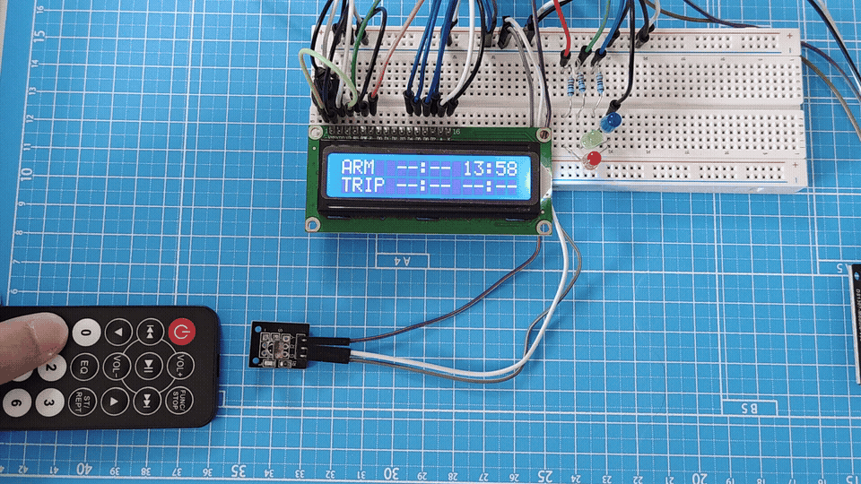

* Tripping motion sensor

 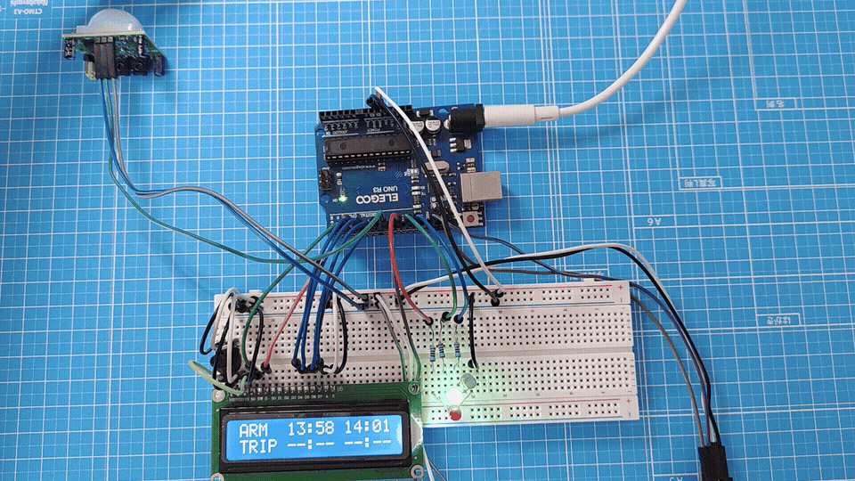

Here are the set up instructions.

## Step 1. Gather components and assemble detector

* Purchase either the parts separately or together from a **[kit](https://www.elegoo.com/products/elegoo-uno-most-complete-starter-kit)**.

* Parts list:
  - 1 x ELEGOO UNO R3 Arduino
  - 1 x ELEGOO 830 Breadboard
  - 1 x DS1307 Real Time Clock
  - 1 x LCD1602 alphanumeric display
  - 1 x aixin AX-1838HS InfraRed receiver
  - 1 x HC-SR501 Passive InfraRed motion sensor
  - 1 x InfraRed remote
  - 1 x PHER PT-15 15mm carbon Potentiometer
  - 3 x 220Ω resistors
  - 20 x Breadboard jumper wires
  - 10 x Female-to-Male Dupont wires
  - 1 x 9V1A Adapter
  - 1 x USB 2 Standard-B male to USB 2 Standard-A male cable

* Refer to the schematic below to assemble the components. 

 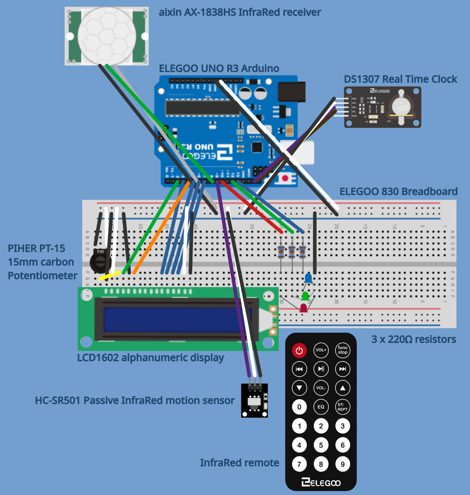

 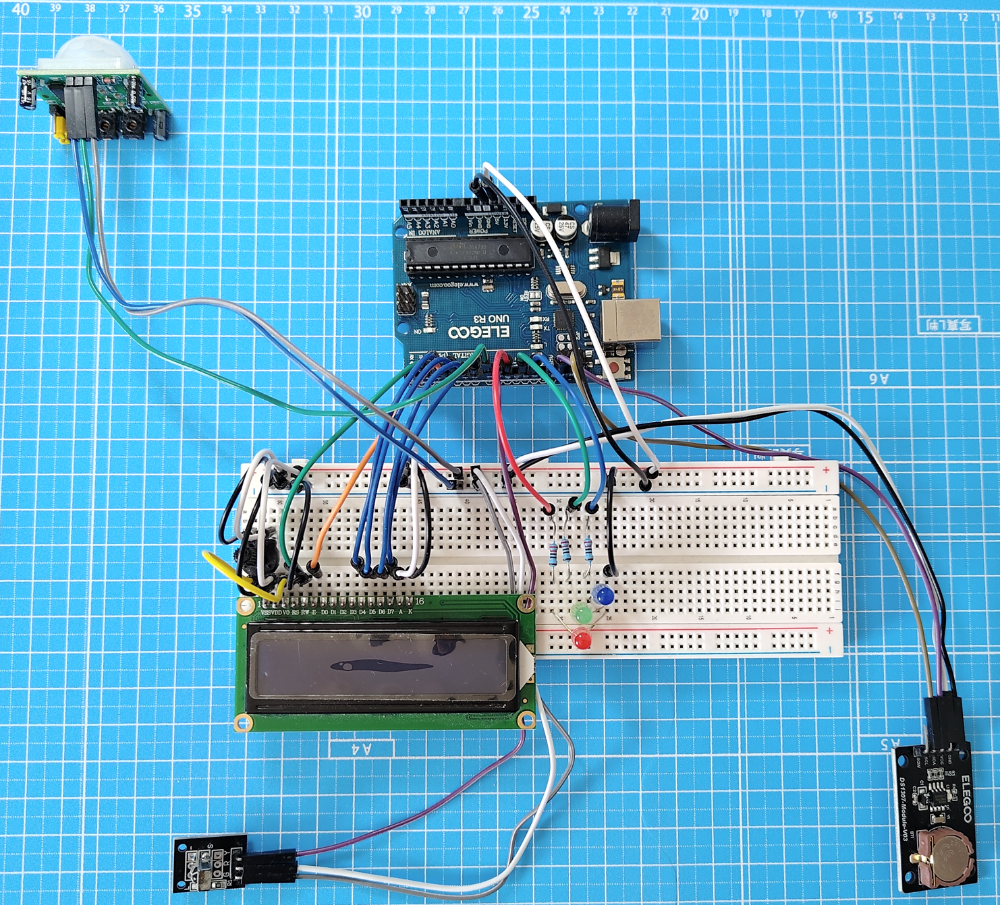

**Note**: You can download the LibreOffice Impress presentation file for this schematic **[from my GitHub](https://github.com/makuharistudio/makuharistudio.github.io/raw/refs/heads/main/source/assets/blog/ELEGOO%20motion%20detector.odp)**.

## Step 2. Install Arduino IDE

* **[https://www.arduino.cc/en/software](https://www.arduino.cc/en/software)**.

## Step 3. Create project folder and files

* For a Linux system, create a folder `~/Arduino/motion_sensor_clock`, then add these files to it:

 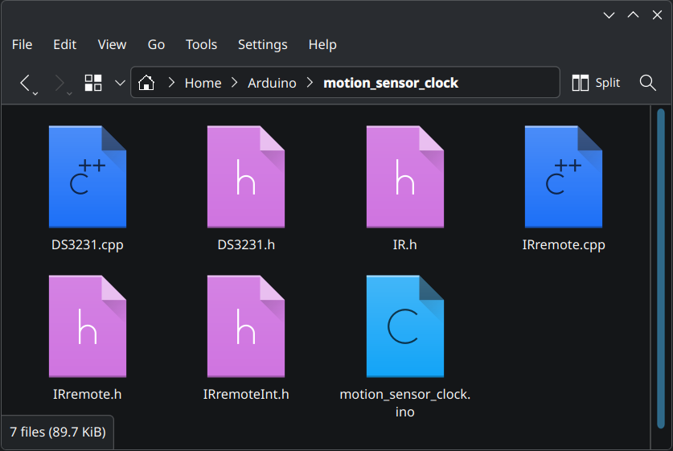


* Main code: `motion_sensor_clock.ino`

```
#include <Wire.h>
#include "DS3231.h"
#include "IRremote.h"
#include "IR.h"
#include <LiquidCrystal.h>
#include <EEPROM.h>

// UNO R3 PIN CONNECTIONS

#define LIGHT_BLUE    13
#define LIGHT_GREEN   12
#define LIGHT_RED     10

#define LED_BOARD     13
#define SENSOR_PIR     8

#define LCD_D7         7
#define LCD_D6         6
#define LCD_D5         5
#define LCD_D4         3
#define LCD_E          4
#define LCD_RS         2

#define IR_RECEIVER    9

// EEPROM: 6 bytes each ("HH:MM" + terminating 0). First byte not '0'-'9' = empty/null
// PAUSE: 0 = no (detect), 1 = yes (ignore PIR trips)
#define EEPROM_ARMED    0
#define EEPROM_TRIP1    6
#define EEPROM_TRIP2    12
#define EEPROM_PAUSE    18
#define EEPROM_COMPILE  20

#define PIR_WARMUP_MS      30000UL
#define PIR_EXIT_DELAY_MS  180000UL   // 3 minutes after arm before PIR can trip

DS3231         clock;
RTCDateTime    dt;
int            value_pir;
int            lastPirState = LOW;
bool           pirBaselineSeen = false;  // must see LOW after delay before a trip counts
unsigned long  bootMillis = 0;
unsigned long  pirListenFrom = 0;        // when the 3-minute exit delay started
IRrecv         irrecv(RECEIVER);
decode_results results;
LiquidCrystal  lcd(LCD_RS, LCD_E, LCD_D4, LCD_D5, LCD_D6, LCD_D7);

char armedTime[6];
char trip1Time[6];
char trip2Time[6];
byte pauseFlag = 0;   // EEPROM PAUSE: 0 = no, 1 = yes

const char compileStamp[] = __DATE__ __TIME__;

// CUSTOM FUNCTIONS
void print2digits(int value) {
  if (value < 10) lcd.print('0');
  lcd.print(value);
}

bool eepromHasTime(int addr) {
  byte first = EEPROM.read(addr);
  return (first >= '0' && first <= '9');
}

void eepromReadTime(int addr, char *buf) {
  if (!eepromHasTime(addr)) {
    buf[0] = '\0';
    return;
  }
  for (int i = 0; i < 6; i++) {
    buf[i] = EEPROM.read(addr + i);
  }
  buf[5] = '\0';
}

void eepromWriteTime(int addr, const char *buf) {
  for (int i = 0; i < 6; i++) {
    EEPROM.update(addr + i, buf[i]);
  }
}

void eepromClearTime(int addr) {
  EEPROM.update(addr, 0);
}

byte eepromReadPause() {
  byte value = EEPROM.read(EEPROM_PAUSE);
  if (value != 0 && value != 1) {
    value = 0;
    EEPROM.update(EEPROM_PAUSE, 0);
  }
  return value;
}

void eepromWritePause(byte value) {
  EEPROM.update(EEPROM_PAUSE, value);
}

bool isNewUpload() {
  for (int i = 0; compileStamp[i] != '\0'; i++) {
    if (EEPROM.read(EEPROM_COMPILE + i) != (byte)compileStamp[i]) {
      return true;
    }
  }
  return false;
}

void saveCompileStamp() {
  for (int i = 0; compileStamp[i] != '\0'; i++) {
    EEPROM.update(EEPROM_COMPILE + i, compileStamp[i]);
  }
  EEPROM.update(EEPROM_COMPILE + strlen(compileStamp), 0);
}

void syncRtcIfNewUpload() {
  // New compile/upload → set RTC from the laptop compile time
  // Power restore with the same sketch → leave the battery-backed RTC alone
  if (isNewUpload()) {
    clock.setDateTime(__DATE__, __TIME__);
    saveCompileStamp();
  }
}

void formatCurrentTime(char *buf) {
  buf[0] = '0' + (dt.hour / 10);
  buf[1] = '0' + (dt.hour % 10);
  buf[2] = ':';
  buf[3] = '0' + (dt.minute / 10);
  buf[4] = '0' + (dt.minute % 10);
  buf[5] = '\0';
}

void setLights(bool red, bool green, bool blue) {
  digitalWrite(LIGHT_RED, red ? HIGH : LOW);
  digitalWrite(LIGHT_GREEN, green ? HIGH : LOW);
  digitalWrite(LIGHT_BLUE, blue ? HIGH : LOW);
}

void applyStageLights() {
  if (pauseFlag == 1 && armedTime[0] != '\0') {
    setLights(true, true, true);      // STAGE 5 — pause, all lights on
  } else if (trip1Time[0] != '\0') {
    setLights(true, false, false);    // STAGE 3 / 4 — red only
  } else if (armedTime[0] != '\0') {
    setLights(false, true, false);    // STAGE 2 — green only
  } else {
    setLights(false, false, true);    // STAGE 1 — blue only
  }
}

void showStoredField(int col, int row, const char *stored) {
  lcd.setCursor(col, row);
  if (stored[0] == '\0') {
    lcd.print("--:--");
  } else {
    lcd.print(stored);
  }
}

void refreshStoredTimesOnLcd() {
  // ARM  ARMED  CURRENT
  showStoredField(5, 0, armedTime);
  // TRIP TRIP1  TRIP2
  showStoredField(5, 1, trip1Time);
  showStoredField(11, 1, trip2Time);
}

void startPirExitDelay() {
  // Throw away any PIR state from "person still in the room"
  pirListenFrom = millis();
  pirBaselineSeen = false;
  lastPirState = digitalRead(SENSOR_PIR);
}

bool exitDelayDone() {
  return (millis() - pirListenFrom) >= PIR_EXIT_DELAY_MS;
}

bool pirIsReady() {
  // 3-minute exit delay after arm (or after power restore still in Stage 2)
  if (!exitDelayDone()) {
    return false;
  }

  // After the delay, do not compare start-of-delay vs end-of-delay.
  // Wait for a fresh LOW, then only a later LOW→HIGH counts as a trip.
  if (!pirBaselineSeen) {
    if (value_pir == LOW) {
      pirBaselineSeen = true;
      lastPirState = LOW;
    }
    return false;
  }

  if (millis() - bootMillis < PIR_WARMUP_MS) {
    return false;
  }
  return true;
}

// CORE CODE

void setup() {
  pinMode(LIGHT_RED, OUTPUT);
  pinMode(LIGHT_GREEN, OUTPUT);
  pinMode(LIGHT_BLUE, OUTPUT);

  Serial.begin(9600);
  clock.begin();
  syncRtcIfNewUpload();

  pinMode(LED_BOARD, OUTPUT);
  pinMode(SENSOR_PIR, INPUT);
  digitalWrite(LED_BOARD, LOW);

  irrecv.enableIRIn();

  // Set up the LCD's number of columns and rows
  lcd.begin(16, 2);

  // Exact spacing, 16 characters on each row
  // ARM  --:-- --:--
  lcd.setCursor(0, 0);
  lcd.print("ARM  --:-- --:--");

  // TRIP --:-- --:--
  lcd.setCursor(0, 1);
  lcd.print("TRIP --:-- --:--");

  eepromReadTime(EEPROM_ARMED, armedTime);
  eepromReadTime(EEPROM_TRIP1, trip1Time);
  eepromReadTime(EEPROM_TRIP2, trip2Time);
  pauseFlag = eepromReadPause();   // PAUSE: 0 = no, 1 = yes
  refreshStoredTimesOnLcd();
  applyStageLights();

  bootMillis = millis();
  lastPirState = digitalRead(SENSOR_PIR);
  pirBaselineSeen = false;

  // Still in Stage 2 after power restore: give another 3 minutes + fresh baseline
  if (armedTime[0] != '\0' && trip1Time[0] == '\0') {
    startPirExitDelay();
  } else {
    pirListenFrom = millis() - PIR_EXIT_DELAY_MS;  // delay already satisfied
  }
}

void loop() {
  // Motion sensor runs constantly
  value_pir = digitalRead(SENSOR_PIR);
  bool newTrip = (value_pir == HIGH && lastPirState == LOW);
  lastPirState = value_pir;

  // Do not blink the red LED after the first trip (pin 13 is shared)
  if (trip1Time[0] == '\0' && pauseFlag == 0) {
    digitalWrite(LED_BOARD, value_pir);
  }

  // Get current time from the RTC module (battery-backed)
  dt = clock.getDateTime();

  // Live clock — second time field on line 1
  lcd.setCursor(11, 0);
  print2digits(dt.hour);
  lcd.print(':');
  print2digits(dt.minute);

  // STAGE 3 / 4 — PIR ignored until armed, not paused, delay over, baseline refreshed
  if (armedTime[0] != '\0' && pauseFlag == 0 && pirIsReady() && newTrip) {
    if (trip1Time[0] == '\0') {
      // STAGE 3 — first trip only
      formatCurrentTime(trip1Time);
      eepromWriteTime(EEPROM_TRIP1, trip1Time);
      refreshStoredTimesOnLcd();
      applyStageLights();
    } else {
      // STAGE 4 — most recent trip (allowed to overwrite TRIP2)
      formatCurrentTime(trip2Time);
      eepromWriteTime(EEPROM_TRIP2, trip2Time);
      refreshStoredTimesOnLcd();
    }
  }

  // IR remote control detection
  int tmpValue;
  if (irrecv.decode(&results)) // Received an IR signal?
  {
    if (results.value == KEY_1) {
      // STAGE 2 — arm
      if (armedTime[0] == '\0') {
        formatCurrentTime(armedTime);
        eepromWriteTime(EEPROM_ARMED, armedTime);
        startPirExitDelay();
        refreshStoredTimesOnLcd();
        applyStageLights();
      }
      Serial.println("1");
    }
    else if (results.value == KEY_2) {
      // STAGE 5 pause / STAGE 6 resume
      if (armedTime[0] != '\0') {
        if (pauseFlag == 0) {
          pauseFlag = 1;            // STAGE 5 — PAUSE yes
          eepromWritePause(pauseFlag);
          applyStageLights();
        } else {
          pauseFlag = 0;            // STAGE 6 — resume
          eepromWritePause(pauseFlag);
          startPirExitDelay();      // leaving the room again after pause
          applyStageLights();
        }
      }
      Serial.println("2");
    }
    else if (results.value == KEY_0) {
      // STAGE 7 — reset only if already armed
      if (armedTime[0] != '\0') {
        armedTime[0] = '\0';
        trip1Time[0] = '\0';
        trip2Time[0] = '\0';
        pauseFlag = 0;              // PAUSE back to no
        eepromClearTime(EEPROM_ARMED);
        eepromClearTime(EEPROM_TRIP1);
        eepromClearTime(EEPROM_TRIP2);
        eepromWritePause(0);
        refreshStoredTimesOnLcd();
        applyStageLights();
      }
      Serial.println("0");
    }
    else {
      for (int i = 0; i < 23; i++)
      {
        if ((keyValue[i] == results.value) && (i < KEY_NUM))
        {
          Serial.println(keyBuf[i]);
          tmpValue = results.value;
        }
        else if (REPEAT == i)
        {
          results.value = tmpValue;
        }
      }
    }
    irrecv.resume(); // Receive the next value
  }

  /*
  Serial.print(dt.hour);
  Serial.print(":");
  Serial.println(dt.minute);
  */
}
```

**Dependency files**

* `DS3231.cpp` and `DS3231.h` by Korneliusz Jarzebski.
  - **[https://github.com/jarzebski/Arduino-DS3231/blob/dev/src/DS3231.cpp](https://github.com/jarzebski/Arduino-DS3231/blob/dev/src/DS3231.cpp)**.
  - **[https://github.com/jarzebski/Arduino-DS3231/blob/dev/src/DS3231.h](https://github.com/jarzebski/Arduino-DS3231/blob/dev/src/DS3231.h)**.

* `IRremote.cpp`, `IRremote.h`, and `IRremoteInt.h` by Ken Shirriff.
  - **[https://github.com/johnmccombs/arduino-libraries/blob/master/IRremote/IRremote.cpp](https://github.com/johnmccombs/arduino-libraries/blob/master/IRremote/IRremote.cpp)**
  - **[https://github.com/johnmccombs/arduino-libraries/blob/master/IRremote/IRremote.h](https://github.com/johnmccombs/arduino-libraries/blob/master/IRremote/IRremote.h)**
  - **[https://github.com/johnmccombs/arduino-libraries/blob/master/IRremote/IRremoteInt.h](https://github.com/johnmccombs/arduino-libraries/blob/master/IRremote/IRremoteInt.h)**

* `IR.h` by ELEGOO from Part 2 lesson 13 IR Receiver Module.

```
#ifndef _IR_H
#define _IR_H

#define RECEIVER 9

#define KEY_POWER (0xFFA25D)
#define KEY_FUNC_STOP (0xFFE21D)
#define KEY_VOL_ADD (0xFF629D)
#define KEY_FAST_BACK (0xFF22DD)
#define KEY_PAUSE (0xFF02FD)
#define KEY_FAST_FORWARD (0xFFC23D)
#define KEY_DOWN (0xFFE01F)
#define KEY_VOL_DE (0xFFA857)
#define KEY_UP (0xFF906F)
#define KEY_EQ (0xFF9867)
#define KEY_ST_REPT (0xFFB04F)
#define KEY_0 (0xFF6897)
#define KEY_1 (0xFF30CF)
#define KEY_2 (0xFF18E7)
#define KEY_3 (0xFF7A85)
#define KEY_4 (0xFF10EF)
#define KEY_5 (0xFF38C7)
#define KEY_6 (0xFF5AA5)
#define KEY_7 (0xFF42BD)
#define KEY_8 (0xFF4AB5)
#define KEY_9 (0xFF52AD)
#define KEY_REPEAT (0xFFFFFFFF)
#define KEY_NUM 21
#define REPEAT 22

unsigned long
keyValue[]={KEY_POWER,KEY_FUNC_STOP,KEY_VOL_ADD,KEY_FAST_BACK,KEY_PAUSE,KEY_FAST_FORWARD,
    KEY_DOWN,KEY_VOL_DE,KEY_UP,KEY_EQ,KEY_ST_REPT,KEY_0,KEY_1,KEY_2,KEY_3,KEY_4,KEY_5,
    KEY_6,KEY_7,KEY_8,KEY_9,KEY_REPEAT};

char keyBuf[][15]={"POWER","FUNC/STOP","VOL+","FAST BACK","PAUSE","FAST FORWARD","DOWN","VOL-",
        "UP","EQ","ST/REPT","0","1","2","3","4","5","6","7","8","9"};
#endif
```

## Step 4. Install libraries

* From Arduino IDE, install the libraries `LiquidCrystal.h`, `Wire.h`, and `EEPROM.h`.
  - From the menu, Sketch > Include Library > Manage Libraries... > search for each and install.

 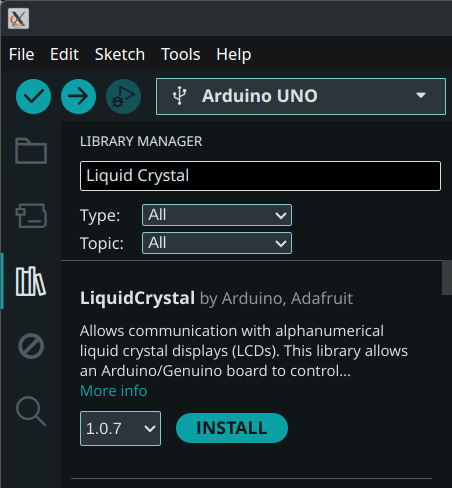

## Step 5. Configure Arduino IDE

* Plug in your Arduino board into your computer with the USB cable. No need for the power adapter yet.

* Open Arduino IDE, from the menu, Tools >
  - Board: "Arduino UNO"
    - Arduino AVR Boards
      - Arduino UNO

 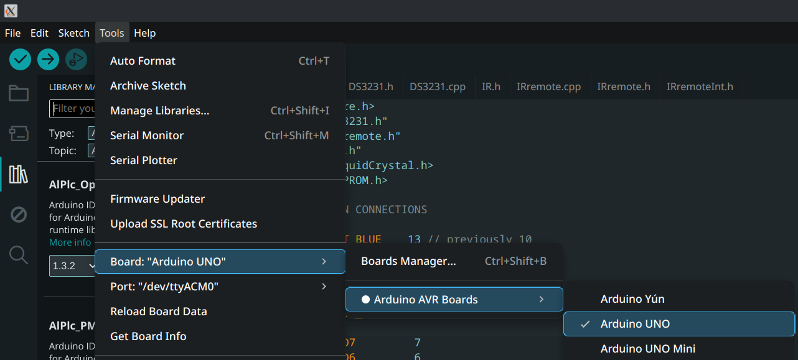

  - Port: "/dev/ttyACM0"
    - /dev/ttyACM0 (Arduino UNO)

 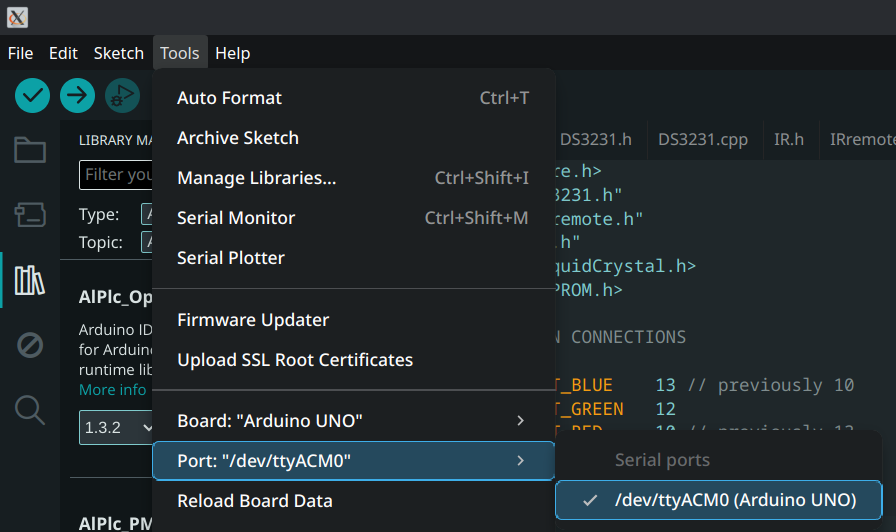

## Step 6. Open the sketch and upload it to the Arduino

* From Arduino IDE, open the motion_sensor_clock sketch, then click the Upload button.

 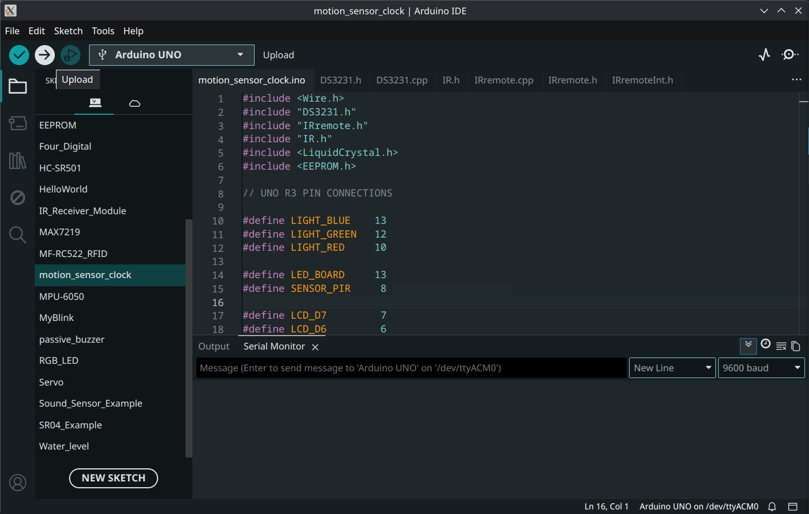

 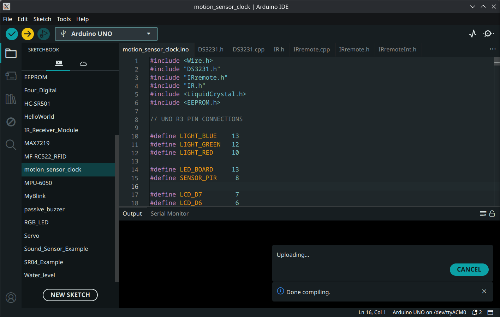

**Note**: During the upload process, you might experience an error like this:

```
OS error: cannot open port /dev/ttyACM0: Permission denied
Error: unable to open port /dev/ttyACM0 for programmer arduino
Failed uploading: uploading error: exit status
```

This is a Linux permissions issue where the Arduino board will not allow you to update it as it is currently owned by root and the `dialout` group. Add your currently logged in user to that group by running this command in Terminal:

```
sudo usermod -a -G dialout $USER
```

Then try uploading the sketch again.

To remove your currently logged in user account from that group, run:

```
sudo gpasswd -d $USER dialout
```

## Step 7. Remove device from computer and plug in AC adapter

* After the sketch upload is successful, remove the USB cable from the Arduino. Then plug the AC adapter into the Arduino.

 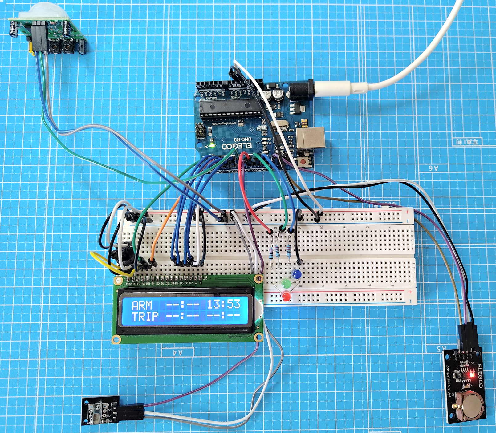

## Instructions

* Lights

```
Light   Meaning   What the system is doing
-----------------------------------------------------
Blue    Unarmed   Solid: Waiting to be armed.
                  Flash: Movement detected.
Green   Armed     Watching for motion.
Red     Tripped   Alarm has been triggered.
All     Paused    Freezes data (except current time).
```

* LCD

```
LCD                    Description
ARM  HH:MM HH:MM   ←   ARM  armed time     current time
TRIP HH:MM HH:MM   ←   TRIP first motion   latest motion
```

* Remote control

```
Button   Action           When it works
----------------------------------------------------
1        Arm system       Only when blue light is on.
2        Pause / Resume   Any point after armed.
0        Reset system     Any point after armed.
```

* Pseudo-code description of sensor functionality

```
WHEN THE ARDUINO TURNS ON:
    Read the last saved times and pause status from memory
    Show them on the LCD
    Turn on the correct light (blue / green / red / all)
    If it was already armed, give you 3 minutes to leave the room

EVERY MOMENT AFTER THAT:
    Read the current time from the clock and show it on the screen

    IF the system is ARMED 
       AND not paused 
       AND the 3-minute exit delay has finished 
       AND the sensor sees motion:
            Save the current time as a “trip”
            - First trip goes into TRIP1 (first motion)
            - Later trips overwrite TRIP2 (latest motion)
            Turn the red light on

    IF a remote button is pressed:
        IF button 1 AND system is idle (blue light on):
            Save current time as “armed time”
            Start the 3-minute exit delay
            Turn the green light on

        IF button 2 AND system is armed (green or red light on):
            Toggle pause on/off
            - Pause = freeze the display and ignore motion (turn all lights on)
            - Resume = start a new 3-minute exit delay then turn green or red light only on

        IF button 0 AND system is armed (green or red light on):
            Clear all saved times
            Turn the blue light on (back to idle)

WHEN POWER IS LOST:
    Arduino turns off completely, stopping all functionality

    Two things stay alive:
        1. The DS3231 clock module (because it has a small battery)
           - Clock still keeps ticking

        2. The Arduino's EEPROM memory
           - Remembers the last saved values, including:
              - Armed time
              - Trip 1 time
              - Trip 2 time
              - Pause on/off status

WHEN POWER COMES BACK:
    Arduino starts from the beginning
    It reads the saved times and pause status from EEPROM
    It reads the current time from the DS3231 clock
    It turns on the correct light (blue / green / red / all)
    It shows the saved times on the LCD
    If it was armed, it starts a fresh 3-minute exit delay
```


Click **[here](https://github.com/makuharistudio/makuharistudio.github.io/blob/main/source/markdown/posts/2026-11-10.md)** for this post's markdown file in GitHub.
