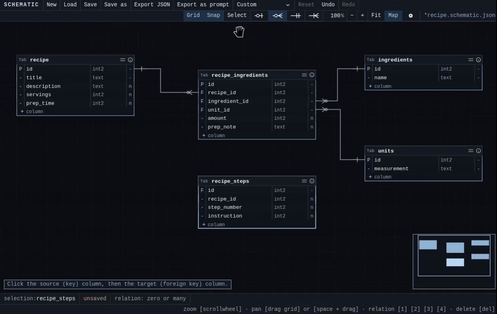

You can download and install this single-page offline web app from GitHub: **[https://github.com/makuharistudio/schematic](https://github.com/makuharistudio/schematic)**.

This project is a tool that allows a developer to visually create their project's data schema as thoroughly as they can, then export it in an AI prompt-friendly format.

It helps minimise back-and-forth between the developer and the AI with the intended advantage of refactoring cost reduction by lowering token costs otherwise wasted from changes to the underlying application structure (a.k.a. refactoring).

For example:
If a developer notices problems or wants new features for their application, AI's refactoring can spend much more token costs scouring the already built code. This incurs higher relative token cost compared to building afresh, and may end up harming other parts of the application, causing an expensive loop.

This is essentially a workflow-based solution to help get the foundations right, so the rest of the build process goes as efficiently as possible. It is more geared toward those who need to be more process and/or cost efficient.

Please note, there are more prolific and well-integrated alternatives:

* **[erd-editor by SeungHwan-Lee: ](https://github.com/dineug/erd-editor)** **[https://erd-editor.io](https://erd-editor.io)**

* **[drawDB: ](https://github.com/drawdb-io/drawdb)** **[https://www.drawdb.app](https://www.drawdb.app)**

This lightweight application is similar to any other database visualisation or Entity Relationship Diagram (ERD) software. It is another free and open source alternative that was built over 2 days. Ironically, the second day was the most expensive as it involved refactoring and introducing new features.

Feature summary by Grok:

* **Design schemas visually**: Create tables and other entity types, add columns, set keys, data types, and nullability, and see everything update live on an interactive canvas.

* **Draw real relationships**: Use standard **[crow’s-foot notation](https://grokipedia.com/page/Entity%E2%80%93relationship_model#crows-foot-notation)** to connect columns. Relations are drawn cleanly and stay attached as you move things around.

* **Work the way you want**: Drag entities freely, or switch between automatic layouts including Hierarchical, Force-directed, and Circular. Each layout remembers its own positions, and you can reset any algorithmic layout at any time. Your manual Custom arrangement is always preserved.

* **Edit in depth without clutter**: Open a resizable detail panel for any entity to manage extra information, including comments, indexes, constraints, enums, nested objects, and arrays. Everything autosaves.

* **Stay organised**: Toggle a background grid, turn snapping on or off, zoom with the mouse wheel or pinch gesture, and pan freely. The interface stays usable on both desktop and touch screens.

* **Make it yours**: Switch between professional light, dark, and high-contrast themes. Change font size, language, and other preferences. All labels are translatable.

* **Export for real work**: Save your schema as a clean JSON file, or export a clear natural-language description you can paste straight into an AI assistant to generate code, documentation, or migrations.

* **Own your data**: Everything runs locally in your browser. Your schema lives in a single file you control — no accounts, no cloud lock-in, and no external libraries.

### Credits

* Overall design largely based on **[erd-editor by SeungHwan-Lee](https://github.com/dineug/erd-editor)**.

* Vibe-coded using **[Grok ](https://docs.x.ai/docs/quickstart)** **[Build via terminal](https://docs.x.ai/build/overview)**.

Click **[here](https://github.com/makuharistudio/makuharistudio.github.io/tree/main/source/markdown/projects/2026-11-27.md)** for this project page's markdown file in GitHub.
